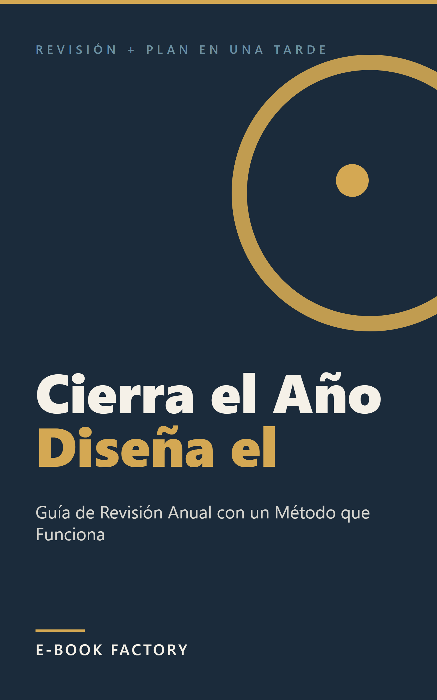

# Revisión humana — EB-000012



| Campo | Valor |
|---|---|
| Título | Cierra el Año y Diseña el Siguiente |
| Subtítulo | Guía de Revisión Anual con un Método que Funciona |
| Autor | E-Book Factory |
| Idioma / Mercado | es-ES / ES |
| Versión | 1.0 |
| Páginas (PDF 6x9) | 27 |
| Formatos | EPUB, PDF |
| QC | **PASS** (auto: PASS, {'PASS': 24}) |
| Riesgo | LOW  |
| Precio sugerido | 2.99 EUR (ESTIMATE) — Precio de impulso para compras de fin de año en Amazon.es Kindle. Coherente con el segmento de guías prácticas cortas en español. La ventana de compra es diciembre-enero, donde el precio bajo facilita la compra por impulso. |
| Colecciones | - |

## Descripción

¿Cómo te ha ido este año? No la versión que le cuentas a los demás, sino la real.

Esta guía te lleva paso a paso por las dos fases que hacen que una revisión de fin de año realmente funcione: primero cierras el año que termina con honestidad y sin autocrítica destructiva, y luego, desde ese cierre, diseñas el siguiente con objetivos que podrás evaluar en diciembre.

Al terminar tendrás:
- Una revisión escrita de las seis áreas principales de tu vida, con al menos un aprendizaje concreto por área
- Tres objetivos para el año siguiente escritos de forma que en diciembre puedas saber con un sí o un no si los cumpliste
- Un esquema de los cuatro trimestres con un foco principal por trimestre

No es una lista de 100 preguntas de reflexión. No es un diario en blanco. Es un método: primero revisas (retrospectiva honesta del año pasado), luego diseñas (plan realista para el siguiente). Las dos fases están conectadas: los aprendizajes del año que termina alimentan directamente los objetivos del siguiente.

El proceso completo lleva entre dos y tres horas. Está pensado para hacerse en una tarde, no como un proyecto de un mes.

Para adultos de 25 a 45 años que quieren hacer un balance de fin de año con estructura, no con una lista de preguntas sueltas de blog. Para quien ya leyó libros de hábitos y gestión del tiempo y quiere un proceso concreto, no motivación genérica.

Sin promesas de transformación radical. Sin metodologías complejas. Solo un proceso claro que en diciembre del año siguiente podrás evaluar como lo que fue.

## Keywords

- revisión anual
- propósitos año nuevo
- balance fin de año
- planificación personal
- objetivos personales
- desarrollo personal
- reflexión anual

## Categorías

- Tienda Kindle > No ficción > Autoayuda > Motivación y superación personal
- Libros > Autoayuda > Productividad y gestión del tiempo
- Libros > Autoayuda > Motivación y superación personal

## Warnings / puntos a revisar

- Ninguno

## Archivos

- cover: `design/cover.png`
- cover_jpg: `design/cover.jpg`
- epub: `build/EB-000012_cierra-el-ano-y-disena-el-siguiente_v1.0.epub`
- pdf: `build/EB-000012_cierra-el-ano-y-disena-el-siguiente_v1.0.pdf`
- Informe QC: `reports/qc_report.md`, `reports/qc_auto.md`
- Informe edición: `reports/editing_report.md`; fact-check: `reports/factcheck_report.md`

## Decisión

```
python factory.py approve EB-000012 --by <SOCIO> [--author "Pen Name"] [--notes "..."]
python factory.py request-changes EB-000012 --by <SOCIO> --restart-at EDIT --notes "qué cambiar"
python factory.py reject EB-000012 --by <SOCIO> --notes "motivo"
```
